# JARKOM MODUL 3 | K-33 (DHCP)

## Anggota

| Nama | NRP |
| :--- | :--- |
| Jonathan Steven Tjahjaputra | 5027251036 |
| Helen Audya Yuniarini | 5027251069 |
---

## Soal 1

### A. Penjelasan
Mengonfigurasi pengalamatan IP statis dan default gateway pada seluruh node infrastruktur jaringan Jujutsu High (DMZ dan Data Center) sesuai dengan prefix `10.80.x.x`, serta mengonfigurasi multi-interface pada router jichi yang terhubung langsung ke antarmuka `WAN` `NAT` melalui `eth0` dan empat switch jaringan internal (`eth1` sampai `eth4`). Selain itu, router `jichi` mengaktifkan fitur penerusan paket `IPv4` (IPv4 forwarding) dan Source `NAT` (`Masquerade`) agar seluruh segmen jaringan dapat terhubung lintas zona dan memperoleh akses ke jaringan luar/internet.

---

### B. Konfigurasi

### Topologi
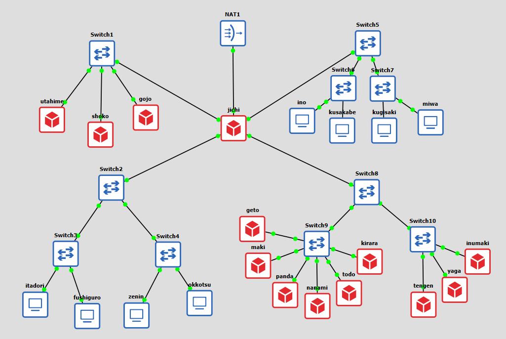

### Konfigurasi

```sh
# Conf di Router jichi
auto eth0
iface eth0 inet dhcp

auto eth1
iface eth1 inet static
    address 10.80.1.1
    netmask 255.255.255.0

auto eth2
iface eth2 inet static
    address 10.80.2.1
    netmask 255.255.255.0

auto eth3
iface eth3 inet static
    address 10.80.3.1
    netmask 255.255.255.0

auto eth4
iface eth4 inet static
    address 10.80.4.1
    netmask 255.255.255.0

    up sysctl -w net.ipv4.ip_forward=1
    up iptables -P FORWARD ACCEPT
    up iptables -t nat -A POSTROUTING -o eth0 -j MASQUERADE

# Conf Host Statis dan Data Center (utahime, shoko, gojo, tengen, geto, maki, panda, nanami, todo, kirara, yaga, inumaki)
auto eth0
iface eth0 inet static
    address 10.80.x.x
    netmask 255.255.255.0
    gateway 10.80.x.1
    up rm -f /etc/resolv.conf && echo "nameserver 192.168.122.1" > /etc/resolv.conf

# Conf Klien (itadori, fushiguro, zenin, okkotsu, ino, kusakabe, miwa, kugisaki)
auto eth0
iface eth0 inet dhcp
```
<br>
<details>
<summary><b>TABEL ROUTING</b> (Expand)</summary>

| Node | Interface | Address | Gateway | Peran / Zona |
| :--- | :--- | :--- | :--- | :--- |
| **jichi** | eth0 | DHCP | - | Router WAN (NAT1) |
| **jichi** | eth1 | 1.1 | - | Gateway Network 1 (DMZ) |
| **jichi** | eth2 | 2.1 | - | Gateway Network 2 (Divisi A) |
| **jichi** | eth3 | 3.1 | - | Gateway Network 3 (Divisi B) |
| **jichi** | eth4 | 4.1 | - | Gateway Network 4 (Data Center) |
| **utahime** | eth0 | 1.2 | 1.1 | DNS Master (Network 1) |
| **shoko** | eth0 | 1.3 | 1.1 | DNS Slave (Network 1) |
| **gojo** | eth0 | 1.4 | 1.1 | Public Reverse Proxy (Network 1) |
| **itadori** | eth0 | DHCP Dynamic | 2.1 | Klien DHCP Pool 1 (Network 2) |
| **fushiguro** | eth0 | DHCP Dynamic | 2.1 | Klien DHCP Pool 1 (Network 2) |
| **zenin** | eth0 | DHCP Dynamic | 2.1 | Klien DHCP Pool 2 (Network 2) |
| **okkotsu** | eth0 | DHCP Dynamic | 2.1 | Klien DHCP Pool 2 (Network 2) |
| **ino** | eth0 | DHCP Dynamic | 3.1 | Klien Short Lease (Network 3) |
| **kusakabe** | eth0 | DHCP Dynamic | 3.1 | Klien Short Lease (Network 3) |
| **miwa** | eth0 | DHCP Dynamic | 3.1 | Klien Long Lease (Network 3) |
| **kugisaki** | eth0 | DHCP (Fixed) | 3.1 | Klien Fixed Address (Network 3) |
| **tengen** | eth0 | 4.2 | 4.1 | DHCP Server (Network 4) |
| **geto** | eth0 | 4.3 | 4.1 | Internal Load Balancer (Network 4) |
| **maki** | eth0 | 4.4 | 4.1 | Worker Frontend (Network 4) |
| **panda** | eth0 | 4.5 | 4.1 | Worker Frontend (Network 4) |
| **nanami** | eth0 | 4.6 | 4.1 | Worker API Utama (Network 4) |
| **todo** | eth0 | 4.7 | 4.1 | Worker API Utama (Network 4) |
| **kirara** | eth0 | 4.8 | 4.1 | Worker API Cadangan (Network 4) |
| **yaga** | eth0 | 4.9 | 4.1 | Database Master MariaDB (Network 4) |
| **inumaki** | eth0 | 4.10 | 4.1 | Database Slave MariaDB (Network 4) |

</details>
<br>

Router jichi menerima konfigurasi IP WAN secara otomatis melalui DHCP pada antarmuka eth0, sedangkan port eth1 sampai eth4 bertindak sebagai gateway masing-masing zona jaringan lokal (10.80.1.1 hingga 10.80.4.1). Seluruh node infrastruktur menetapkan IP statis pada port eth0 dengan gateway menuju antarmuka jichi terkait, serta mengarahkan nameserver awal ke IP gateway NAT (192.168.122.1).

---

### C. Pengujian

* Verifikasi Penugasan IP Interface Klien/Server Statis
  ```sh
  ip a show eth0
  ```
  Expected Output:
  Menampilkan rincian status antarmuka eth0 berstatus UP beserta alokasi IP statis (10.80.x.x/24) sesuai host yang dikonfigurasi.

  Membuktikan: Alokasi pengalamatan IP statis berhasil diterapkan pada antarmuka jaringan node infrastruktur.

  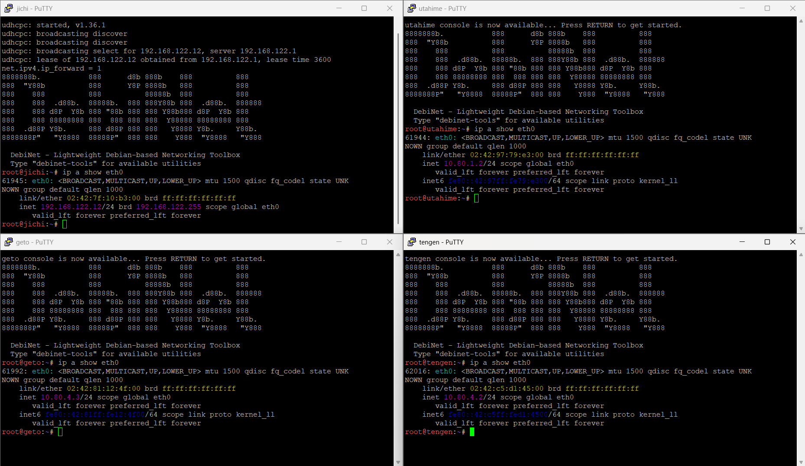

* Verifikasi Status Kernel IPv4 Forwarding pada Router jichi
  ```sh
  cat /proc/sys/net/ipv4/ip_forward
  ```
  Expected Output:
  1

  Membuktikan: Kernel router jichi telah aktif meneruskan paket antarmuka lintas segmen jaringan internal.

* Verifikasi Aturan IPTables POSTROUTING NAT pada Router jichi
  ```sh
  iptables -t nat -L POSTROUTING -n -v
  ```
  Expected Output:
  Terdapat baris aturan berstatus target MASQUERADE pada antarmuka keluar -o eth0.
  
  Membuktikan: Aturan Source NAT (Masquerade) telah aktif untuk meneruskan trafik internal menuju WAN/internet.

  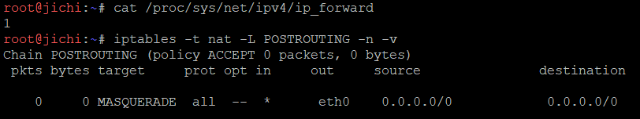

* Uji Konektivitas Node Infrastruktur ke Gateway jichi
  ```sh
  ping -c 3 10.80.1.1
  ```
  Expected Output:
  Tiga paket balasan ICMP diterima normal (3 packets transmitted, 3 received, 0% packet loss).

  Membuktikan: Lapisan jaringan lokal antara host infrastruktur dan gateway router jichi terhubung stabil.

  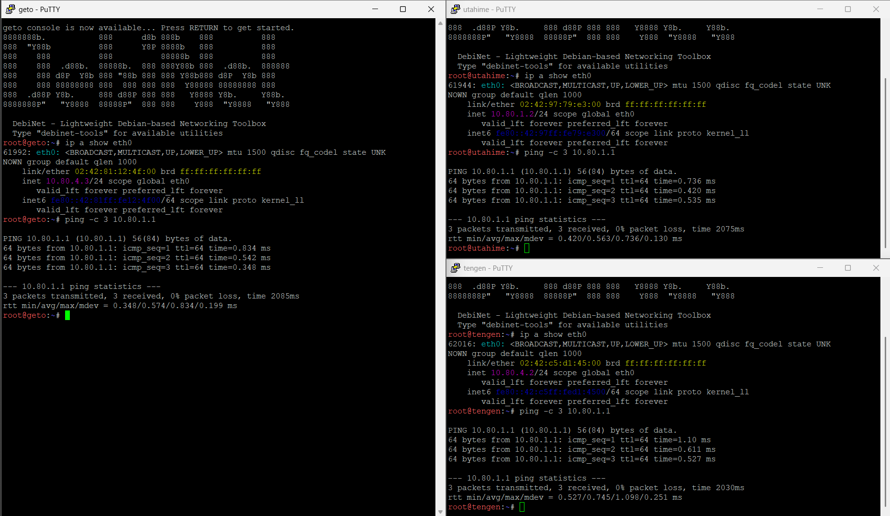

* Uji Akses Keluar / Internet dari Host Statis (misal: utahime atau tengen)
  ```sh
  ping -c 3 192.168.122.1
  ```
  Expected Output:
  Respons balasan ICMP diterima tanpa kendala (0% packet loss).

  Membuktikan: Paket dari host internal berhasil menyeberangi router jichi dan mencapai gateway NAT luar.

  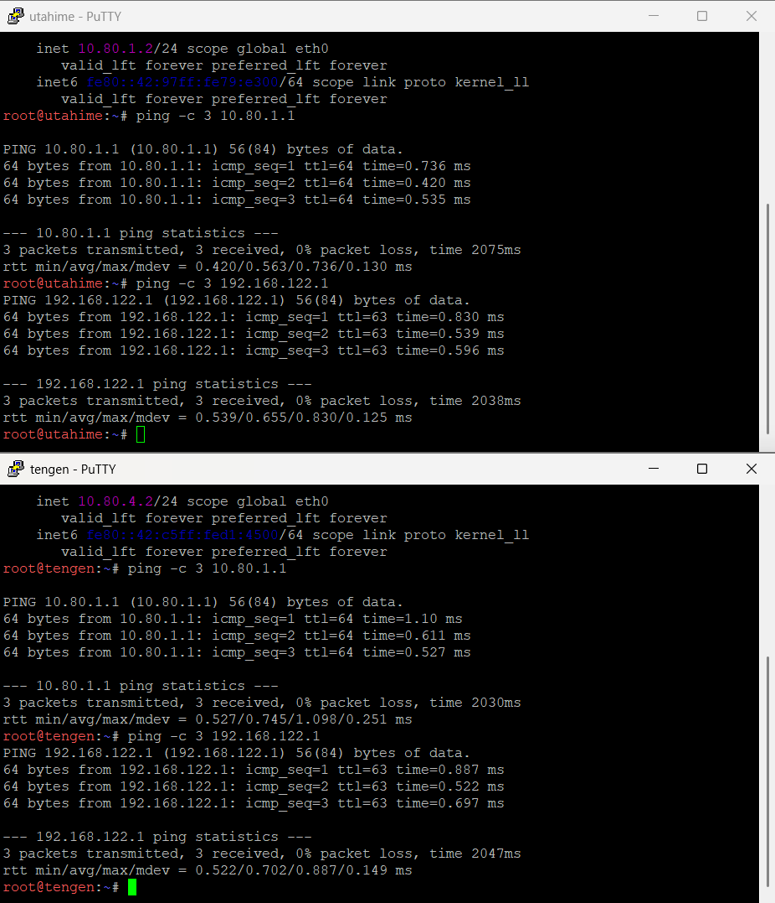

---

## Soal 2

### A. Penjelasan
Mengonfigurasi paket layanan `isc-dhcp-server` pada node `tengen` di Data Center (Network 4) dengan alamat IP `10.80.4.10`. Konfigurasi mencakup pengikatan antarmuka `eth0` sebagai interface operasional daemon DHCP IPv4, mendeklarasikan subnet lokal Network 4 (`10.80.4.0/24`) tanpa range dinamis agar `dhcpd` dapat berjalan normal tanpa galat `No subnet declaration for eth0`, serta mendeklarasikan scope subnet untuk Network 2 (`10.80.2.0/24`) dan Network 3 (`10.80.3.0/24`) lengkap dengan opsi gateway dan nameserver awal.

---

### B. Konfigurasi
```sh
# Conf di node tengen
    up which dhcpd || (apt-get update && apt-get install -y isc-dhcp-server)
    up echo 'INTERFACESv4="eth0"' > /etc/default/isc-dhcp-server
    up echo 'INTERFACESv6=""' >> /etc/default/isc-dhcp-server
    up echo 'default-lease-time 600;' > /etc/dhcp/dhcpd.conf
    up echo 'max-lease-time 7200;' >> /etc/dhcp/dhcpd.conf
    up echo 'ddns-update-style none;' >> /etc/dhcp/dhcpd.conf
    up echo 'authoritative;' >> /etc/dhcp/dhcpd.conf
    up echo '' >> /etc/dhcp/dhcpd.conf
    up echo 'subnet 10.80.4.0 netmask 255.255.255.0 {' >> /etc/dhcp/dhcpd.conf
    up echo '}' >> /etc/dhcp/dhcpd.conf
    up echo '' >> /etc/dhcp/dhcpd.conf
    up echo 'subnet 10.80.2.0 netmask 255.255.255.0 {' >> /etc/dhcp/dhcpd.conf
    up echo '    option routers 10.80.2.1;' >> /etc/dhcp/dhcpd.conf
    up echo '    option subnet-mask 255.255.255.0;' >> /etc/dhcp/dhcpd.conf
    up echo '    option domain-name-servers 192.168.122.1;' >> /etc/dhcp/dhcpd.conf
    up echo '}' >> /etc/dhcp/dhcpd.conf
    up echo '' >> /etc/dhcp/dhcpd.conf
    up echo 'subnet 10.80.3.0 netmask 255.255.255.0 {' >> /etc/dhcp/dhcpd.conf
    up echo '    option routers 10.80.3.1;' >> /etc/dhcp/dhcpd.conf
    up echo '    option subnet-mask 255.255.255.0;' >> /etc/dhcp/dhcpd.conf
    up echo '    option domain-name-servers 192.168.122.1;' >> /etc/dhcp/dhcpd.conf
    up echo '}' >> /etc/dhcp/dhcpd.conf
    up /etc/init.d/isc-dhcp-server restart 2>/dev/null
```

Paket `isc-dhcp-server` dipasang secara otomatis jika biner `dhcpd` belum ditemukan. File `/etc/default/isc-dhcp-server` dikonfigurasikan agar layanan mengikat antarmuka `eth0`. Berkas `/etc/dhcp/dhcpd.conf` diatur dengan parameter global lease time, status `authoritative`, deklarasi subnet lokal `10.80.4.0/24` tanpa blok range dinamis agar daemon `dhcpd` mengenali subnet antarmukanya sendiri, serta deklarasi blok subnet Network 2 dan Network 3 yang akan melayani permohonan IP dari relay `jichi`. Layanan kemudian direstart menggunakan skrip init sistem.

---

### C. Pengujian

* Uji Validasi Sintaks Konfigurasi DHCP
  ```sh
  dhcpd -t -cf /etc/dhcp/dhcpd.conf
  ```
  Expected Output:
  Tidak memunculkan pesan error sintaksis maupun peringatan `No subnet declaration for eth0`.

  Membuktikan: Konfigurasi file `dhcpd.conf` valid dan deklarasi subnet lokal Network 4 telah dikenali daemon tanpa memicu galat `No subnet declaration`.

* Verifikasi Status Berjalan Service isc-dhcp-server
  ```sh
  /etc/init.d/isc-dhcp-server status
  ```
  Expected Output:
  Menampilkan status daemon `dhcpd` berstatus `running` atau mencantumkan proses aktif (`PID`).

  Membuktikan: Layanan DHCP server aktif berjalan di latar belakang dan siap melayani permintaan sewa alamat.

* Verifikasi Port Listening Layanan
  ```sh
  netstat -ulpn | grep dhcpd
  ```
  Expected Output:
  Menampilkan soket `0.0.0.0:67` berstatus `listening` oleh proses `dhcpd`.

  Membuktikan: Antarmuka server telah membuka port `UDP 67` untuk menerima paket permohonan DHCP dari relay router `jichi`.
<br><br>
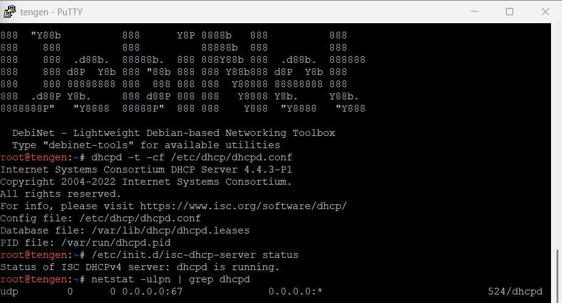
---
## Soal 3

### A. Penjelasan
Mengonfigurasi router `jichi` sebagai DHCP Relay Agent menggunakan paket `isc-dhcp-relay` agar siaran permohonan IP dari klien di Network 2 (Divisi A via `eth2`) dan Network 3 (Divisi B via `eth3`) dapat diteruskan secara unicast ke server DHCP `tengen` (`10.80.4.10`) di Network 4. Konfigurasi ini memastikan klien lintas subnet tetap dapat memperoleh konfigurasi IP secara dinamis tanpa memerlukan DHCP server terpisah di setiap segmen.

---

### B. Konfigurasi
```sh
# Conf di Router jichi
    up echo "isc-dhcp-relay isc-dhcp-relay/servers string 10.80.4.10" | debconf-set-selections 2>/dev/null
    up echo "isc-dhcp-relay isc-dhcp-relay/interfaces string eth2 eth3 eth4" | debconf-set-selections 2>/dev/null
    up echo "isc-dhcp-relay isc-dhcp-relay/options string " | debconf-set-selections 2>/dev/null

    up which dhcrelay || (apt-get update && apt-get install -y isc-dhcp-relay)
    up echo 'SERVERS="10.80.4.10"' > /etc/default/isc-dhcp-relay
    up echo 'INTERFACES="eth2 eth3 eth4"' >> /etc/default/isc-dhcp-relay
    up echo 'OPTIONS=""' >> /etc/default/isc-dhcp-relay
    up /etc/init.d/isc-dhcp-relay restart 2>/dev/null

# Conf di seluruh Klien (itadori, fushiguro, zenin, okkotsu, ino, kusakabe, miwa, kugisaki)
    up sh -c 'while ! ip -4 addr show eth0 | grep -q "inet "; do udhcpc -i eth0 -n -q -t 5; sleep 2; done &'
```


Nilai `debconf` di-preseed terlebih dahulu untuk server tujuan, daftar antarmuka yang dipantau, serta opsi tambahan agar proses instalasi berjalan otomatis tanpa jeda input. Paket `isc-dhcp-relay` dipasang jika biner `dhcrelay` belum ada, lalu file `/etc/default/isc-dhcp-relay` diisi konfigurasi IP `tengen` dan interface `eth2`, `eth3`, serta `eth4` sebelum di-restart. Pada seluruh klien, disisipkan loop latar belakang pada antarmuka agar terus mencoba meminta lease IP secara berkala hingga DHCP server selesai melakukan booting.

---

### C. Pengujian

* Verifikasi Status Layanan DHCP Relay pada Router jichi
  ```sh
  ps aux | grep dhcrelay
  ```
  Expected Output:

  ```sh
  root ... /usr/sbin/dhcrelay -q -i eth2 -i eth3 -i eth4 10.80.4.10
  ```

  Membuktikan: Layanan DHCP Relay aktif berjalan di router `jichi` dan mendengarkan permintaan dari antarmuka `eth2`, `eth3`, serta `eth4`.

* Uji Perolehan Lease IP pada Klien Masing-masing Divisi
  ```sh
  ip a show eth0
  ```
  Expected Output:

  ```sh
  # Divisi A
  inet 10.80.2.x/24 scope global eth0

  # Divisi B
  inet 10.80.3.x/24 scope global eth0
  ```

  Membuktikan: Permintaan broadcast DHCP dari Divisi A ataupun B berhasil diseberangkan oleh relay `jichi` ke server `tengen` dan klien menerima konfigurasi IP.

* Uji Gateway dan Konektivitas Klien ke Router
  ```sh
  ping -c 3 10.80.2.1
  ```
  Expected Output:
  ```sh
  3 packets transmitted, 3 received, 0% packet loss
  ```
  Membuktikan: Konfigurasi default gateway yang dibagikan DHCP server melalui relay terpasang dengan benar dan berfungsi normal pada rute klien.
<br><br>
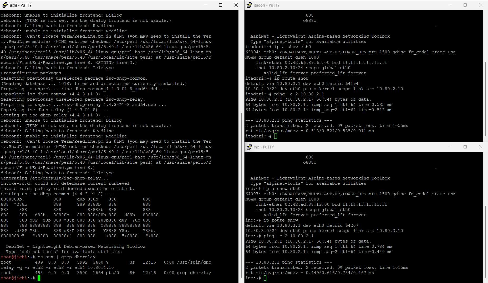

---

## Soal 4

### A. Penjelasan
Mengonfigurasi pembagian alokasi alamat IP dinamis pada Network 2 (Divisi A) ke dalam dua *pool* terpisah menggunakan fitur DHCP Class pada server `tengen` (`10.80.4.10`). Klien tim pengembang (`itadori` dan `fushiguro`) dikelompokkan ke dalam kelas `dev-team` untuk menerima jatah IP Pool 1 (`10.80.2.10`–`10.80.2.35`), sedangkan klien tim pendukung (`zenin` dan `okkotsu`) dikelompokkan ke dalam kelas `support-team` untuk menerima jatah IP Pool 2 (`10.80.2.70`–`10.80.2.95`). Rentang alamat `10.80.2.36`–`10.80.2.69` sengaja diisolasi agar tidak dialokasikan ke perangkat mana pun di dalam subnet.

---

### B. Konfigurasi
```sh
# Conf di tengen (Disisipin sebelum line deklarasi subnet mask)
    up echo 'class "dev-team" {' >> /etc/dhcp/dhcpd.conf
    up echo '    match if (option dhcp-client-identifier = "itadori" or option dhcp-client-identifier = "fushiguro");' >> /etc/dhcp/dhcpd.conf
    up echo '}' >> /etc/dhcp/dhcpd.conf
    up echo '' >> /etc/dhcp/dhcpd.conf
    up echo 'class "support-team" {' >> /etc/dhcp/dhcpd.conf
    up echo '    match if (option dhcp-client-identifier = "zenin" or option dhcp-client-identifier = "okkotsu");' >> /etc/dhcp/dhcpd.conf
    up echo '}' >> /etc/dhcp/dhcpd.conf

# Conf di tengen (Disisipin di dalam Subnet 10.80.2.0)
    up echo '    pool {' >> /etc/dhcp/dhcpd.conf
    up echo '        allow members of "dev-team";' >> /etc/dhcp/dhcpd.conf
    up echo '        range 10.80.2.10 10.80.2.35;' >> /etc/dhcp/dhcpd.conf
    up echo '    }' >> /etc/dhcp/dhcpd.conf
    up echo '    pool {' >> /etc/dhcp/dhcpd.conf
    up echo '        allow members of "support-team";' >> /etc/dhcp/dhcpd.conf
    up echo '        range 10.80.2.70 10.80.2.95;' >> /etc/dhcp/dhcpd.conf
    up echo '    }' >> /etc/dhcp/dhcpd.conf

# Conf di Node itadori, update line soal 3
    up nohup sh -c 'while ! ip -4 addr show eth0 | grep -q "inet "; do udhcpc -i eth0 -x 61:697461646f7269 -n -t 5 -T 2; sleep 3; done' >/dev/null 2>&1 &

# Conf di Node fushiguro, update line soal 3
    up nohup sh -c 'while ! ip -4 addr show eth0 | grep -q "inet "; do udhcpc -i eth0 -x 61:66757368696775726f -n -t 5 -T 2; sleep 3; done' >/dev/null 2>&1 &

# Conf di Node zenin, update line soal 3
    up nohup sh -c 'while ! ip -4 addr show eth0 | grep -q "inet "; do udhcpc -i eth0 -x 61:7a656e696e -n -t 5 -T 2; sleep 3; done' >/dev/null 2>&1 &

# Conf di Node okkotsu, update line soal 3
    up nohup sh -c 'while ! ip -4 addr show eth0 | grep -q "inet "; do udhcpc -i eth0 -x 61:6f6b6b6f747375 -n -t 5 -T 2; sleep 3; done' >/dev/null 2>&1 &
```

---

Pada server `tengen`, didefinisikan dua class penanda yang mencocokkan muatan Client Identifier (Option 61) untuk memisahkan anggota `dev-team` dan `support-team`. Di dalam blok subnet `10.80.2.0`, dibuat dua pool spesifik dengan arahan `allow members of` untuk masing-masing kelas sehingga IP `10.80.2.10`–`10.80.2.35` dialokasikan untuk dev dan `10.80.2.70`–`10.80.2.95` untuk support, sekaligus meninggalkan rentang `10.80.2.36`–`10.80.2.69` kosong tak teralokasi. Pada sisi antarmuka klien Divisi A, disisipkan loop retry berlatar belakang yang resisten terhadap boot race condition (menggunakan `nohup`) dengan mengirimkan Client Identifier dalam format heksadesimal (`-x 61:<hex>`) agar permintaan lease otomatis dieksekusi hingga memperoleh alamat dari pool yang sesuai.

---

### C. Pengujian

* Uji Alokasi IP Pool 1 pada Klien Tim Dev (itadori)
  ```sh
  ip a show eth0
  ```
  Expected Output:
  ```sh
  # itadori
  inet 10.80.2.10/24 scope global eth0

  # fushiguro
  inet 10.80.2.11/24 scope global eth0

  # zenin
  inet 10.80.2.70/24 scope global eth0

  # okkotsu
  inet 10.80.2.71/24 scope global eth0
  ```
  Membuktikan: Node-node tsb berhasil dicocokkan ke dalam DHCP class `dev-team` dan memperoleh jatah alamat IP dalam rentang Pool 1 (`10.80.2.10`–`10.80.2.35`) maupun Pool 2 (`10.80.2.70`–`10.80.2.95`).

* Verifikasi Isolasi Rentang Terlarang pada Server tengen
  ```sh
  grep -E "lease 10\.80\.2\." /var/lib/dhcp/dhcpd.leases
  ```
  Expected Output:
  ```sh
  lease 10.80.2.10 {
  lease 10.80.2.11 {
  lease 10.80.2.70 {
  lease 10.80.2.71 {
  ```
  Membuktikan: Server `tengen` mencatat seluruh transaksi sewa klien berada di rentang pool yang diizinkan dan tidak ada satupun lease yang teralokasi pada rentang terlarang (`10.80.2.36`–`10.80.2.69`).
<br><br>
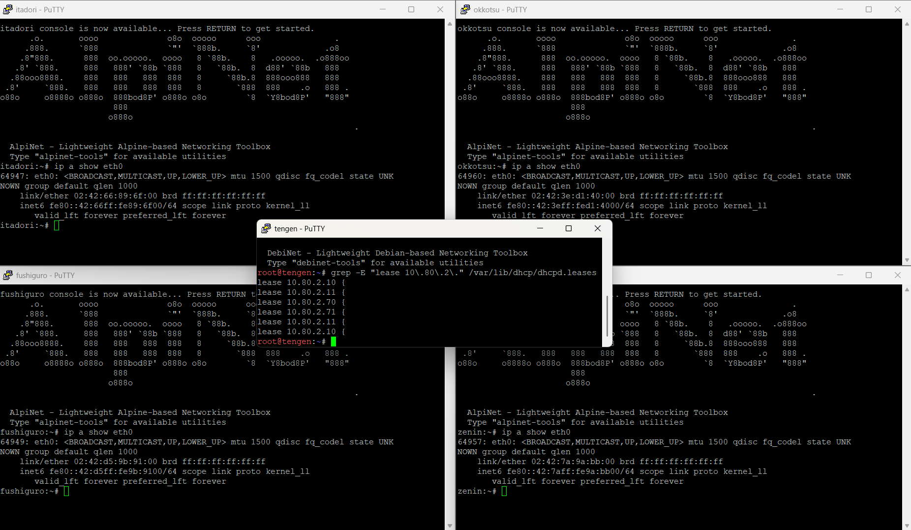

---

## Soal 5

### A. Soal
Setiap tim lapangan memiliki durasi operasi yang berbeda. Pada `Network 3` (`10.80.3.0/24`), berikan `short lease` 30 menit (`1800` detik) kepada `ino` dan `kusakabe`, serta `long lease` 12 jam (`43200` detik) kepada `miwa`. Gunakan pool `short lease` (`10.80.3.10`–`10.80.3.89`) dan pool `long lease` (`10.80.3.100`–`10.80.3.199`). Sesuaikan `default-lease-time` dan `max-lease-time` untuk setiap kelas client. Berikan pula DHCP options berupa DNS `10.80.1.2` dan `10.80.1.3`, serta `domain-search` `Kel33.com`.

---

### B. Konfigurasi

```sh
# Update config tengen
auto eth0
iface eth0 inet static
    address 10.80.4.10
    netmask 255.255.255.0
    gateway 10.80.4.1
    up hostname tengen
    up echo "tengen" > /etc/hostname
    up rm -f /etc/resolv.conf && echo "nameserver 192.168.122.1" > /etc/resolv.conf

    # Setupnya sekarang lewat file shell di root karna gampang banget rusak kemaren
    up /bin/sh /root/setup.sh

# Skrip pada file setup tengen (/root/setup.sh)
#!/bin/sh
while ! ping -c 1 -W 1 10.80.4.1 >/dev/null 2>&1; do sleep 1; done
if ! which dhcpd >/dev/null 2>&1; then
    rm -rf /etc/apt/sources.list.d/*
    echo "deb [trusted=yes check-valid-until=no] http://deb.debian.org/debian trixie main" > /etc/apt/sources.list
    apt-get update -o Acquire::Check-Valid-Until=false -o Acquire::Check-Date=false
    apt-get install -y --allow-unauthenticated isc-dhcp-server
fi

echo 'INTERFACESv4="eth0"' > /etc/default/isc-dhcp-server
echo 'INTERFACESv6=""' >> /etc/default/isc-dhcp-server

cat << 'CONFIG' > /etc/dhcp/dhcpd.conf
ddns-update-style none;
authoritative;
default-lease-time 600;
max-lease-time 7200;

subnet 10.80.4.0 netmask 255.255.255.0 {}

class "dev-team" {
    match if (substring(option dhcp-client-identifier, 0, 7) = "itadori" or substring(option dhcp-client-identifier, 1, 7) = "itadori" or option dhcp-client-identifier = "itadori" or substring(option dhcp-client-identifier, 0, 9) = "fushiguro" or substring(option dhcp-client-identifier, 1, 9) = "fushiguro" or option dhcp-client-identifier = "fushiguro");
}
class "support-team" {
    match if (substring(option dhcp-client-identifier, 0, 5) = "zenin" or substring(option dhcp-client-identifier, 1, 5) = "zenin" or option dhcp-client-identifier = "zenin" or substring(option dhcp-client-identifier, 0, 7) = "okkotsu" or substring(option dhcp-client-identifier, 1, 7) = "okkotsu" or option dhcp-client-identifier = "okkotsu");
}
subnet 10.80.2.0 netmask 255.255.255.0 {
    option routers 10.80.2.1;
    option subnet-mask 255.255.255.0;
    option domain-name-servers 192.168.122.1;
    pool {
        allow members of "dev-team";
        range 10.80.2.10 10.80.2.35;
    }
    pool {
        allow members of "support-team";
        range 10.80.2.70 10.80.2.95;
    }
}

# Soal 5
class "short-lease" {
    match if (substring(option dhcp-client-identifier, 0, 3) = "ino" or substring(option dhcp-client-identifier, 1, 3) = "ino" or option dhcp-client-identifier = "ino" or substring(option dhcp-client-identifier, 0, 8) = "kusakabe" or substring(option dhcp-client-identifier, 1, 8) = "kusakabe" or option dhcp-client-identifier = "kusakabe");
    default-lease-time 1800;
    max-lease-time 1800;
}
class "long-lease" {
    match if (substring(option dhcp-client-identifier, 0, 4) = "miwa" or substring(option dhcp-client-identifier, 1, 4) = "miwa" or option dhcp-client-identifier = "miwa");
    default-lease-time 43200;
    max-lease-time 43200;
}
subnet 10.80.3.0 netmask 255.255.255.0 {
    option routers 10.80.3.1;
    option subnet-mask 255.255.255.0;
    option domain-name-servers 10.80.1.2, 10.80.1.3;
    option domain-search "Kel33.com";
    pool {
        allow members of "short-lease";
        range 10.80.3.10 10.80.3.89;
    }
    pool {
        allow members of "long-lease";
        range 10.80.3.100 10.80.3.199;
    }
}
# Soal 5
CONFIG

mkdir -p /var/lib/dhcp /run /var/run
touch /var/lib/dhcp/dhcpd.leases
rm -f /var/run/dhcpd.pid /run/dhcpd.pid
killall dhcpd 2>/dev/null || true
dhcpd -q -4 -cf /etc/dhcp/dhcpd.conf eth0

# Conf di ino
auto eth0
iface eth0 inet manual
    up ip link set eth0 up
    up nohup sh -c 'while ! ip -4 addr show eth0 | grep -q "inet 10.80.3."; do udhcpc -i eth0 -x 61:696e6f -n -s /usr/share/udhcpc/default.script; sleep 2; done' >/dev/null 2>&1 &

# Conf di kusakabe
auto eth0
iface eth0 inet manual
    up ip link set eth0 up
    up nohup sh -c 'while ! ip -4 addr show eth0 | grep -q "inet 10.80.3."; do udhcpc -i eth0 -x 61:6b7573616b616265 -n -s /usr/share/udhcpc/default.script; sleep 2; done' >/dev/null 2>&1 &

# Conf di miwa
auto eth0
iface eth0 inet manual
    up ip link set eth0 up
    up nohup sh -c 'while ! ip -4 addr show eth0 | grep -q "inet 10.80.3."; do udhcpc -i eth0 -x 61:6d697761 -n -s /usr/share/udhcpc/default.script; sleep 2; done' >/dev/null 2>&1 &
```

Konfigurasi `network interfaces` pada node `tengen` diarahkan untuk memicu eksekusi skrip `/root/setup.sh` secara otomatis saat booting. Skrip setup mengelola instalasi paket `isc-dhcp-server` serta menuliskan konfigurasi `dhcpd.conf` yang memisahkan pool Subnet 3 ke dalam class `short-lease` (durasi `1800` detik) dan `long-lease` (durasi `43200` detik), lengkap dengan DNS serta `domain-search` kelompok. Masing-masing node klien Divisi B menjalankan daemon `udhcpc` di latar belakang dengan DHCP Client-Identifier heksadesimal untuk mengikat alokasi IP yang tepat ke antarmuka.

---

### C. Pengujian

* Verifikasi Penugasan IP dan DNS Option pada semua klien yang di-aim soal
  ```sh
  ip -br a show eth0
  cat /etc/resolv.conf
  ```
  Expected Output:

  `ino` memegang IP `10.80.3.10/24` (rentang `10.80.3.10`–`10.80.3.89`), dan berkas `resolv.conf` memuat `nameserver 10.80.1.2` serta `nameserver 10.80.1.3`, `kusakabe` memegang IP `10.80.3.11/24` (rentang `10.80.3.10`–`10.80.3.89`), dan `miwa` memegang IP `10.80.3.100/24` (rentang `10.80.3.100`–`10.80.3.199`).

  Membuktikan:

  klien ino mendapatkan pool short lease, kusakabe berhasil masuk ke alokasi pool short lease, miwa berhasil masuk ke alokasi pool long lease, dan opsi DNS berhasil diinjeksikan secara dinamis.

* Verifikasi Durasi Waktu Sewa (Lease Time) di tengen
  ```sh
  grep -A 8 -E "lease 10.80.3." /var/lib/dhcp/dhcpd.leases
  ```
  Expected Output:

  Selisih waktu baris `starts` dan `ends` pada entri lease `ino`/`kusakabe` tepat 30 menit (`1800` detik), sedangkan pada entri lease `miwa` tepat 12 jam (`43200` detik).

  Membuktikan:
  
  Konnfigurasi `default-lease-time` dan `max-lease-time` per kelas client diterapkan secara presisi oleh server.
<br><br>
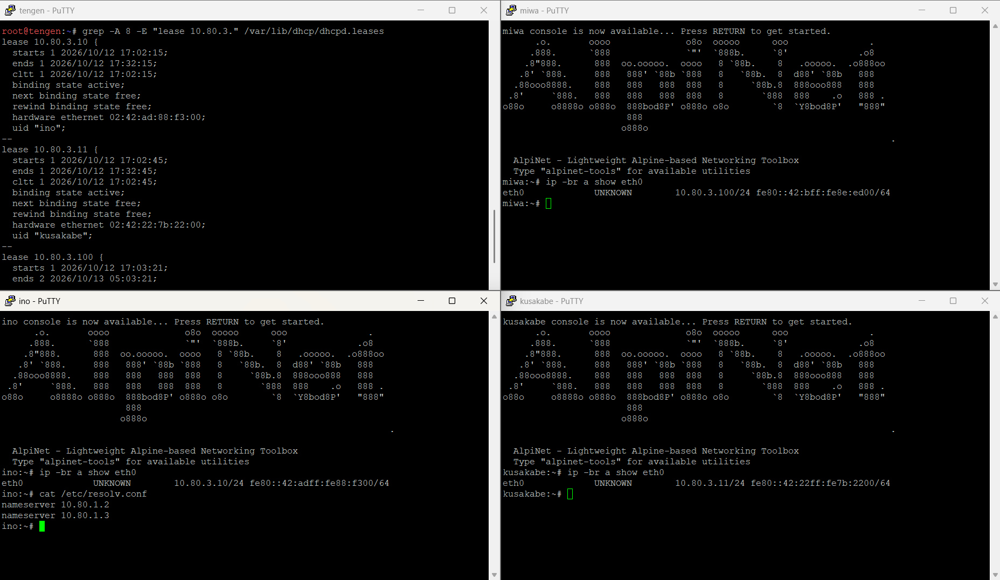

---

## Soal 6

### A. Soal
`Kugisaki` ditetapkan sebagai personel VIP yang harus mempertahankan alamat yang sama setiap kali terhubung. Buat DHCP static lease berdasarkan MAC Address client tersebut dengan fixed address `10.80.3.99`. Pastikan alamat ini berada di luar seluruh pool dinamis, validasi konfigurasi server, lalu renew lease pada client. Buktikan bahwa alamat yang diterima sesuai dengan reservasi.

---

### B. Konfigurasi
```sh
# Tambahan sebelum line CONFIG di tengen
# Soal 6
host kugisaki {
    hardware ethernet 02:42:53:d1:7b:00;
    fixed-address 10.80.3.99;
}
# Soal 6

# Validasi konfigurasi server sebelum daemon dijalankan ulang
dhcpd -t -cf /etc/dhcp/dhcpd.conf && dhcpd -q -4 -cf /etc/dhcp/dhcpd.conf eth0

# Conf di kugisaki
auto eth0
iface eth0 inet manual
    up ip link set eth0 up
    up /bin/sh /root/setup.sh

# Isi file setup.sh kugisaki
cat << 'EOF' > /root/setup.sh
#!/bin/sh
nohup sh -c 'while ! ip -4 addr show eth0 | grep -q "inet 10.80.3.99"; do udhcpc -i eth0 -n -s /usr/share/udhcpc/default.script; sleep 2; done' >/dev/null 2>&1 &
EOF
chmod +x /root/setup.sh
```

Pada server `tengen`, ditambahkan blok reservasi host `kugisaki` yang mengikat MAC Address fisik `02:42:53:d1:7b:00` ke `fixed-address` `10.80.3.99`, di mana alamat ini berada di luar rentang pool dinamis `short-lease` (`10.80.3.10`–`10.80.3.89`) maupun `long-lease` (`10.80.3.100`–`10.80.3.199`). Validasi berkas dilakukan menggunakan perintah `dhcpd -t` sebelum menjalankan daemon `dhcpd`. Node klien `kugisaki` dikonfigurasi untuk menjalankan permohonan IP otomatis secara persisten hingga memperoleh IP reservasi tersebut.

---

### C. Pengujian

* Verifikasi Penugasan Fixed Address dan Gateway pada kugisaki

  ```sh
  ip -br a show eth0
  ip route show
  ```
  Expected Output:

  Interface `eth0` berstatus `UP` dengan IP `10.80.3.99/24` serta rute default mengarah ke gateway `10.80.3.1`.

  Membuktikan:
  
  Bahwa alamat yang diterima oleh klien `kugisaki` sesuai dengan reservasi static lease yang ditetapkan.
<br><br>
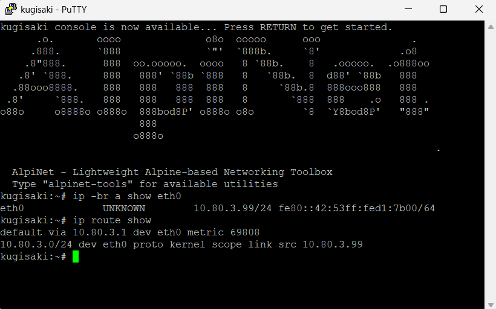

---

## Soal 7

### A. Soal
Setelah aturan alokasi diterapkan, pastikan setiap client menerima konfigurasi jaringan sesuai wilayahnya: subnet mask `255.255.255.0` (`/24`), gateway dan broadcast address yang benar, DNS `10.80.1.2` serta `10.80.1.3`, dan `domain-search` yang ditentukan. Periksa IP address dan routing seluruh client Divisi A dan Divisi B, kemudian cocokkan lease dengan `/var/lib/dhcp/dhcpd.leases` pada `tengen`. Pastikan tidak ada alamat yang bertabrakan atau berada di luar kebijakan pool.

---

### B. Konfigurasi
```sh
# Update /root/setup.sh Server tengen
option domain-name-servers 10.80.1.2, 10.80.1.3;
option domain-search "Kel33.com";

subnet 10.80.2.0 netmask 255.255.255.0 {
    option routers 10.80.2.1;
    option subnet-mask 255.255.255.0;
    option broadcast-address 10.80.2.255;
    pool {
        allow members of "dev-team";
        range 10.80.2.10 10.80.2.35;
    }
    pool {
        allow members of "support-team";
        range 10.80.2.70 10.80.2.95;
    }
}

subnet 10.80.3.0 netmask 255.255.255.0 {
    option routers 10.80.3.1;
    option subnet-mask 255.255.255.0;
    option broadcast-address 10.80.3.255;
    pool {
        allow members of "short-lease";
        range 10.80.3.10 10.80.3.89;
    }
    pool {
        allow members of "long-lease";
        range 10.80.3.100 10.80.3.199;
    }
}

# Skrip pada file setup Klien Divisi A (itadori, fushiguro, zenin, okkotsu) karena sempet konflik gara-gara setup nomor sebelumnya
cat << 'EOF' > /root/setup.sh
#!/bin/sh
killall udhcpc 2>/dev/null
ip addr flush dev eth0
cat << 'SCRIPT' > /tmp/udhcpc.sh
#!/bin/sh
[ "$1" = "bound" ] || [ "$1" = "renew" ] || exit 0
ip addr add $ip/${mask:-24} broadcast ${broadcast:-10.80.2.255} dev $interface
[ -n "$router" ] && ip route add default via $router dev $interface 2>/dev/null
echo -e "nameserver 10.80.1.2\nnameserver 10.80.1.3\nsearch Kel33.com" > /etc/resolv.conf
SCRIPT
chmod +x /tmp/udhcpc.sh
nohup sh -c 'while ! ip -4 addr show eth0 | grep -q "inet 10.80.2."; do udhcpc -i eth0 -x (Isi bagian ini disesuaiin ama Hexa masing-masing) -n -s /tmp/udhcpc.sh; sleep 2; done' >/dev/null 2>&1 &
EOF
chmod +x /root/setup.sh
```

Pada berkas `dhcpd.conf` server `tengen` ditambahkan opsi global `domain-name-servers` (`10.80.1.2` dan `10.80.1.3`) serta `domain-search` `Kel33.com`, serta option `broadcast-address` pada masing-masing blok subnet `10.80.2.0/24` dan `10.80.3.0/24`. Pada sisi klien Divisi A, skrip setup memproses paket DHCP `bound`/`renew` secara mandiri menggunakan skrip handler kustom untuk memastikan pengikatan IP, broadcast `10.80.2.255`, rute default gateway, serta penulisan nameserver ke `/etc/resolv.conf` berjalan tanpa tertimpa konfigurasi NAT.

---

### C. Pengujian

* Verifikasi Subnet Mask, Broadcast Address, Routing, dan Resolver pada Klien Divisi A (Kiri bawah) dan B (Kanan atas)
  ```sh
  ip addr show eth0
  ip route show
  cat /etc/resolv.conf
  ```
  Expected Output:

  Alamat `inet` menunjukkan alokasi IP subnet 2 dengan prefix `/24` dan `brd 10.80.2.255`, default route mengarah via `10.80.2.1 dev eth0`, serta berkas `resolv.conf` menampilkan `nameserver 10.80.1.2`, `nameserver 10.80.1.3`, dan `search Kel33.com` untuk divisi A. Alamat `inet` menunjukkan alokasi IP subnet 3 dengan prefix `/24` dan `brd 10.80.3.255`, default route mengarah via `10.80.3.1 dev eth0`, serta berkas `resolv.conf` menampilkan `nameserver 10.80.1.2`, `nameserver 10.80.1.3`, dan `search Kel33.com` untuk divisi B

  Membuktikan:
  
  Semua Klien telah menerima konfigurasi parameter jaringan lengkap sesuai wilayah subnetnya tanpa residu IP gateway NAT.

* Audit Database Sewa pada Server tengen
  ```sh
  cat /var/lib/dhcp/dhcpd.leases
  ```
  Expected Output:

  Menampilkan seluruh entitas lease aktif untuk Divisi A (rentang `10.80.2.10`–`10.80.2.35` dan `10.80.2.70`–`10.80.2.95`) serta Divisi B (rentang `10.80.3.10`–`10.80.3.89` dan `10.80.3.100`–`10.80.3.199`) dengan hardware MAC/UID yang unik tanpa duplikasi.

  Membuktikan:
  Seluruh alokasi sewa tercatat sah di database DHCP server, berada di dalam batas pool yang ditentukan, dan tidak ada alamat yang bertabrakan.
<br><br>
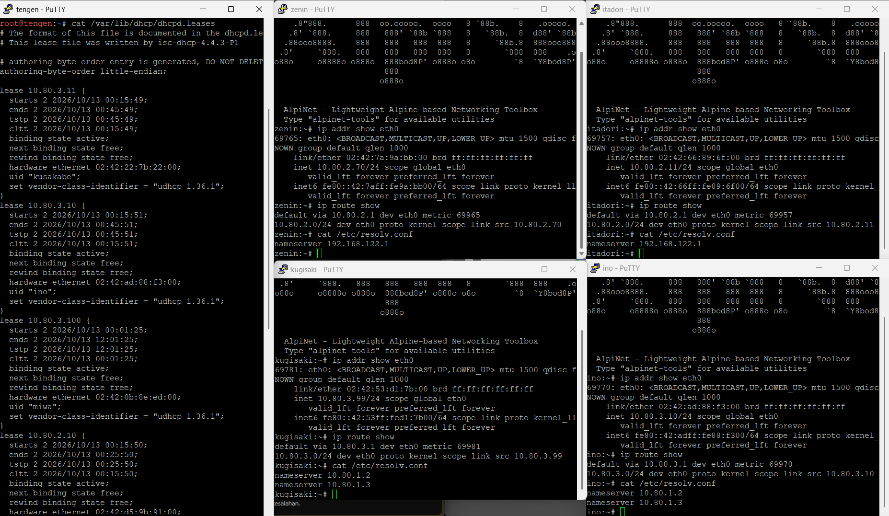

---

## Soal 8

### A. Soal
Sebelum Curtain dibuka kembali, buktikan bahwa proses pemberian alamat berjalan sesuai protokol. Lakukan packet capture saat salah satu client `Network 2` atau `Network 3` meminta lease baru. Gunakan `tcpdump` pada `tengen` atau jalur menuju Data Center untuk menunjukkan urutan `DHCPDISCOVER` → `DHCPOFFER` → `DHCPREQUEST` → `DHCPACK`. Identifikasi alamat server, alamat yang diberikan, lease time, dan field `giaddr`. Pastikan nilai `giaddr` sesuai dengan interface `jichi` yang menerima request dari subnet client.

---

### B. Pengujian

* Capture Urutan Protokol DHCP DORA di 
Server `tengen` (Biarin live, terus lanjutin ke pengujian selanjutnya dulu)
  ```sh
  tcpdump -i eth0 -nv -s 0 port 67 or port 68
  ```
  Expected Output:

  Menampilkan tangkapan paket 4 tahap protokol DHCP secara kronologis berurutan:
  1. Paket BOOTP/DHCP Request (`DHCPDISCOVER`) dari MAC klien (misal `ino`) dengan Gateway-IP (`giaddr`) `10.80.3.1`.
  2. Paket BOOTP/DHCP Reply (`DHCPOFFER`) dari server `10.80.4.10` menawarkan Your-IP `10.80.3.10` dengan Lease-Time `1800s` (atau mendekati) dan Server-ID `10.80.4.10`.
  3. Paket BOOTP/DHCP Request (`DHCPREQUEST`) dari klien meminta Requested-IP `10.80.3.10` ke Server-ID `10.80.4.10` dengan Gateway-IP (`giaddr`) `10.80.3.1`.
  4. Paket BOOTP/DHCP Reply (`DHCPACK`) mengonfirmasi penetapan Your-IP `10.80.3.10` dengan Lease-Time `1800s` (atau mendekati).

  Membuktikan:

  Seluruh siklus alokasi alamat IP berjalan sesuai urutan protokol `DHCPDISCOVER` → `DHCPOFFER` → `DHCPREQUEST` → `DHCPACK`, server identifier terbaca `10.80.4.10`, alamat sewa sesuai alokasi, durasi sewa terkonfirmasi, serta field `giaddr` bernilai `10.80.3.1` yang tepat merepresentasikan antarmuka router relay `jichi` penampung request subnet klien.

* Trigger Permohonan Lease Baru pada Klien (Contoh: ino)
  ```sh
  killall udhcpc 2>/dev/null
  ip addr flush dev eth0
  udhcpc -i eth0 -x 61:696e6f -n -q -s /usr/share/udhcpc/default.script
  ```
  Expected Output:

  Klien mencetak proses `broadcasting discover`, `broadcasting select for 10.80.3.10, server 10.80.4.10`, dan diakhiri dengan `lease of 10.80.3.10 obtained from 10.80.4.10`.

  Membuktikan:
  Sisi klien berhasil mengeksekusi negosiasi lease baru dan menerima parameter jaringan secara penuh dari server DHCP melalui agen relay.
<br><br>
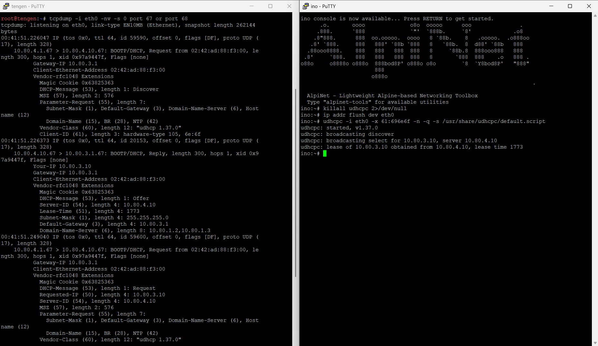

---

## Soal 9

### A. Soal
Sebuah gangguan memutus jalur relay dan membuat permintaan alamat tidak sampai ke Data Center. Hentikan service DHCP Relay pada `jichi`, lalu paksa salah satu client di `Network 2` atau `Network 3` meminta lease baru dan catat gejalanya. Pulihkan service relay, ulangi permintaan DHCP, lalu buktikan bahwa client kembali memperoleh alamat dari pool yang benar dengan gateway semula.

---

### B. Pengujian

* Simulasi Gangguan Service Relay Dihentikan di Router `jichi`
  ```sh
  pkill dhcrelay
  ps aux | grep dhcrelay
  ```
  Expected Output:

  Perintah `pkill` berhasil mengeksekusi penghentian daemon, dan pengecekan `ps aux` menunjukkan proses `dhcrelay` sudah tidak aktif (hanya menyisakan proses `grep`).
  
  Membuktikan:
  
  Pemutusan jalur relay berhasil disimulasikan pada router `jichi`.

* Uji Permintaan Lease Baru saat Relay Terputus, contohnya pada Klien ino
  ```sh
  killall udhcpc 2>/dev/null
  ip addr flush dev eth0
  udhcpc -i eth0 -x 61:696e6f -n -t 3 -s /usr/share/udhcpc/default.script
  ip -br a show eth0
  ```
  Expected Output:

  Klien menampilkan pesan `broadcasting discover` berulang kali hingga timeout tercapai, dan perintah `ip -br a show eth0` menampilkan status antarmuka `eth0` kosong tanpa alamat IPv4.

  Membuktikan: 
  Gejala gangguan di mana broadcast `DHCPDISCOVER` dari klien terisolasi di jaringan lokal dan gagal mencapai server DHCP di Data Center akibat ketiadaan relay agent.

* Pemulihan Service Relay pada Router `jichi`
  ```sh
  /usr/sbin/dhcrelay -4 -i eth2 -i eth3 -i eth4 10.80.4.10
  ps aux | grep dhcrelay
  ```
  Expected Output:
  
  Service `dhcrelay` aktif kembali di background mendengarkan antarmuka `eth2`, `eth3`, dan `eth4` serta meneruskan paket ke `10.80.4.10`.
  
  Membuktikan:
  Jalur forwarding agen DHCP Relay pada `jichi` telah pulih sepenuhnya.

* Uji Permintaan Ulang DHCP pada Klien ino Pasca Pemulihan
  ```sh
  udhcpc -i eth0 -x 61:696e6f -n -q -s /usr/share/udhcpc/default.script
  ip -br a show eth0
  ip route show
  ```
  Expected Output:

  Klien berhasil menyelesaikan negosiasi lease dengan output `lease of 10.80.3.10 obtained from 10.80.4.10`. Pengecekan antarmuka menunjukkan `eth0` memegang IP `10.80.3.10/24` (pool `short-lease` Network 3) dan rute default kembali aktif mengarah ke gateway `10.80.3.1 dev eth0`.

  Membuktikan: 
  Bahwa setelah service relay dipulihkan, klien dapat kembali memperoleh konfigurasi IP yang valid dari pool yang benar beserta gateway asalnya secara normal.
<br><br>
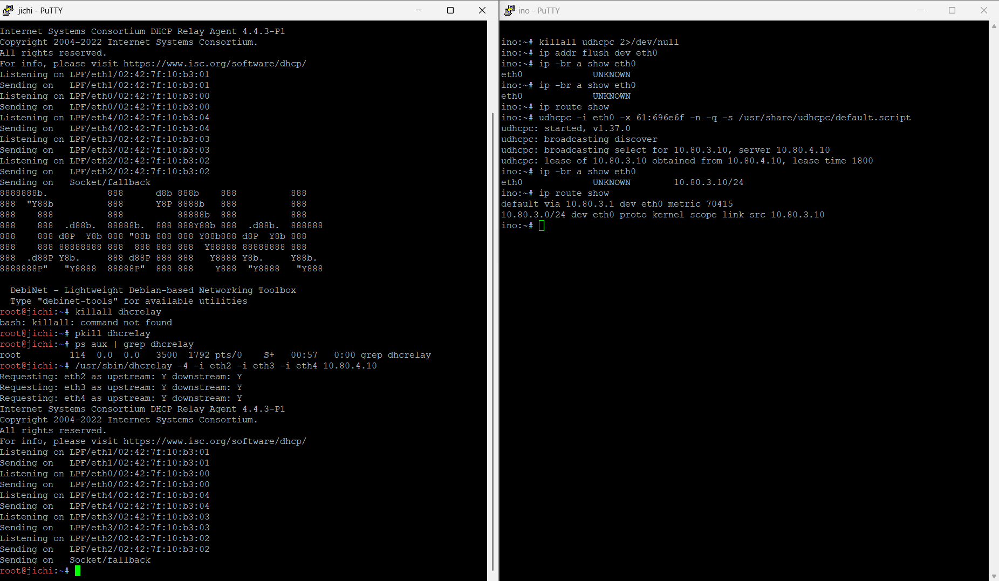

---

## Soal 10

### A. Soal
Setelah gangguan Shibuya tertangani, pastikan pemulihan bertahan setelah restart. Aktifkan autostart DHCP Server pada `tengen` dan DHCP Relay pada `jichi`, lalu restart kedua node. Verifikasi status layanan, IP, gateway, lease, dan konektivitas client `Network 2`–`Network 3`. Pastikan kebijakan Pool 1, Pool 2, `short lease`, `long lease`, dan `fixed address` tetap berlaku.

---

### B. Konfigurasi
```sh
# Update pada Network Config jichi (/etc/network/interfaces)
auto eth0
iface eth0 inet dhcp
    up /root/setup.sh

# Skrip pada file setup jichi (/root/setup.sh)
cat << 'EOF' > /root/setup.sh
#!/bin/sh
sysctl -w net.ipv4.ip_forward=1 >/dev/null
iptables -P FORWARD ACCEPT
iptables -t nat -C POSTROUTING -o eth0 -j MASQUERADE 2>/dev/null || iptables -t nat -A POSTROUTING -o eth0 -j MASQUERADE

if ! which dhcrelay >/dev/null 2>&1; then
    rm -rf /etc/apt/sources.list.d/*
    echo "deb [trusted=yes check-valid-until=no] http://deb.debian.org/debian trixie main" > /etc/apt/sources.list
    apt-get update -o Acquire::Check-Valid-Until=false -o Acquire::Check-Date=false
    apt-get install -y --allow-unauthenticated isc-dhcp-relay
fi

while ! ping -c 1 -W 1 10.80.4.10 >/dev/null 2>&1; do sleep 1; done
pkill dhcrelay 2>/dev/null || true
/usr/sbin/dhcrelay -4 -i eth2 -i eth3 -i eth4 10.80.4.10
EOF
chmod +x /root/setup.sh

# Update pada Network Config tengen (/etc/network/interfaces)
auto eth0
iface eth0 inet static
    address 10.80.4.10
    netmask 255.255.255.0
    gateway 10.80.4.1
    up /root/setup.sh
```

Mekanisme autostart diterapkan dengan memanggil `/root/setup.sh` via directive `up` di berkas `/etc/network/interfaces` masing-masing node. Pada `tengen`, skrip memastikan daemon `isc-dhcp-server` langsung aktif mengikat konfigurasi `dhcpd.conf` begitu antarmuka `eth0` menyala. Pada router `jichi`, skrip setup mengaktifkan routing/NAT kernel, memastikan paket `isc-dhcp-relay` terpasang, menunggu kesiapan komunikasi jaringan ke `tengen` (`10.80.4.10`), lalu menjalankan daemon `dhcrelay` di antarmuka `eth2`, `eth3`, dan `eth4` secara otomatis.

---

### C. Pengujian

* Verifikasi Status Layanan DHCP Server pada tengen Pasca-Restart
  ```sh
  ps aux | grep dhcpd
  cat /var/lib/dhcp/dhcpd.leases
  ```
  Expected Output:

  Menampilkan proses `dhcpd -q -4 -cf /etc/dhcp/dhcpd.conf eth0` aktif berjalan di memori, dan berkas sewa `/var/lib/dhcp/dhcpd.leases` tetap menyimpan data lease aktif klien.
  
  Membuktikan:
  Layanan DHCP Server pada `tengen` otomatis aktif kembali setelah node direstart dan integritas basis data alokasi sewa tetap terjaga.

* Verifikasi Status Layanan DHCP Relay pada jichi Pasca-Restart
  ```sh
  ps aux | grep dhcrelay
  ```
  Expected Output:
  
  Menampilkan proses `/usr/sbin/dhcrelay -4 -i eth2 -i eth3 -i eth4 10.80.4.10` aktif mendengarkan antarmuka relay.

  Membuktikan:
  Layanan DHCP Relay pada `jichi` berhasil berjalan otomatis tanpa intervensi manual pasca-reboot.

* Verifikasi Status IP, Gateway, dan Konektivitas Klien Network 2 (Divisi A)
  ```sh
  ip -br a show eth0
  ip route show
  ping -c 2 10.80.2.1
  ```
  Expected Output:
  Klien (`itadori`) memegang IP `10.80.2.11/24` (berada dalam rentang `dev-team` `10.80.2.10`–`10.80.2.35`), default route mengarah ke `10.80.2.1 dev eth0`, dan ping ke gateway menghasilkan `0% packet loss`.

  Membuktikan:
  Alokasi alamat Pool 1 (`dev-team`) dan Pool 2 (`support-team`) serta rute gateway subnet Network 2 tetap dipertahankan dan terhubung dengan normal pasca-restart.

* Verifikasi Status IP, Gateway, dan Konektivitas Klien Network 3 (Divisi B)
  ```sh
  ip -br a show eth0
  ip route show
  ping -c 2 10.80.3.1
  ```
  Expected Output:
  
  Klien (`ino`) memegang IP `10.80.3.10/24` (berada dalam rentang `short-lease` `10.80.3.10`–`10.80.3.89`), default route mengarah ke `10.80.3.1 dev eth0`, dan ping ke gateway menghasilkan `0% packet loss`.
  
  Membuktikan:
  
  Alokasi subnet Network 3 (`short lease`, `long lease`, serta VIP `fixed address`) tetap bekerja stabil dan terhubung penuh ke gateway lokal pasca-restart.
<br><br>
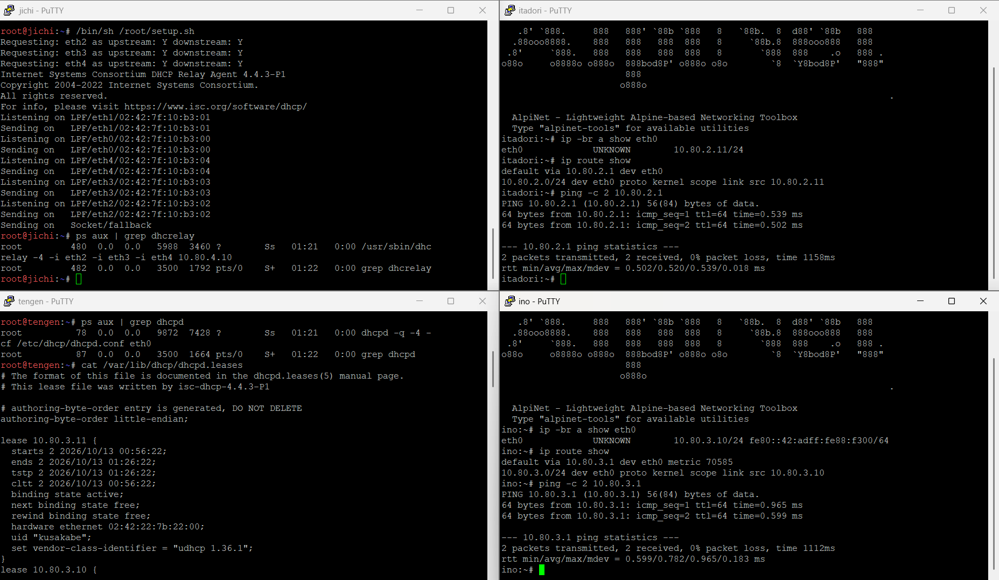